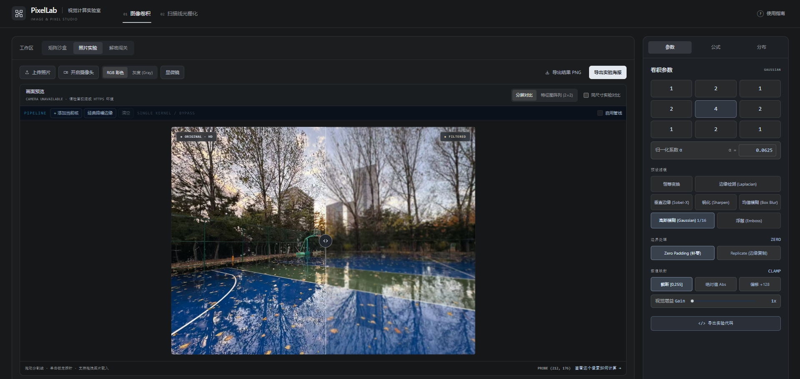

# PixelLab

**像素与视觉沙盒 · 从一张照片，到一个像素的计算过程。**

PixelLab 是一个运行在浏览器中的视觉计算交互实验室，将照片滤波、卷积核编辑、像素公式透视、固定核特征提取与扫描线光栅化放进同一个工作台。适合数字图像处理、计算机图形学和深度学习基础课程中的自主实验、课堂演示与项目展示。

**纯前端 · 单文件 HTML · 无需构建 · 本地图像处理**

[在线体验](http://101.200.57.106/pixellab/) · [查看源文件](./PixelLab%20.html) · [快速运行](#快速运行) · [计算约定与技术边界](#计算约定与技术边界)



*照片实验示例：原图与高斯模糊结果分屏对比，右侧显示当前卷积核与映射参数。*

> 当前在线演示使用 HTTP。照片、矩阵和光栅化实验可直接体验；摄像头模式请在 HTTPS 站点或本机 `localhost` 环境中使用。

## 功能概览

| 模块 | 可以做什么 |
| --- | --- |
| 照片实验 | 内置「雨后球场」照片；支持上传或拖入 JPG、PNG、WebP；拖动分屏线比较原图与滤波结果，切换 RGB / 灰度模式。 |
| 镜像摄像头 | 手动开启摄像头，实时显示水平镜像画面并应用滤镜；支持分屏与特征图阵列。 |
| 卷积参数与流水线 | 编辑 3×3 核、归一化系数 α、增益、后处理和边界策略；最多串联 3 个滤镜，查看中间层。 |
| 像素计算透视 | 点击探针查看邻域与 9 项乘加；支持 R / G / B 通道检查、7×7 像素显微镜和输入 / 输出灰度直方图。 |
| 特征图阵列 | 同一输入并行生成 Sobel-Y、Sobel-X、Sharpen、Gaussian 四张特征图，联动探针、公式与处理阶段。 |
| 矩阵沙盒 | 在 12×12 网格绘制输入，单步或连续播放计算过程，观察卷积窗口逐像素移动。 |
| 解密闯关 | 根据目标输出推断卷积核，完成平移、均值模糊、锐化和十字边缘提取四关。 |
| 扫描线光栅化 | 在 24×24 网格观察活性边表 AET、交点与填充区间；支持预设多边形、自由绘制、SSAA 和 Gouraud 着色演示。 |
| 成果导出 | 下载滤波结果或选中特征图 PNG，导出带参数的实验海报，生成并复制 OpenCV / PyTorch 示例代码。 |

## 快速运行

### 直接打开

下载仓库中的 [`PixelLab .html`](./PixelLab%20.html)，使用浏览器打开即可体验。页面所需样式、脚本和默认照片已包含在 HTML 内，无需安装 Node.js，也不依赖外部 CDN。

文件名在 `PixelLab` 与 `.html` 之间有一个空格，命令行中请保留引号。

### 启动本地服务

安装 Git 和 Python 3 后执行：

```bash
git clone https://github.com/lkn1234566/lkn-1.0.git
cd lkn-1.0
python3 -m http.server 8000 --bind 127.0.0.1
```

然后打开：

[http://localhost:8000/PixelLab%20.html](http://localhost:8000/PixelLab%20.html)

Windows 中若未提供 `python3` 命令，可将其替换为 `python`。摄像头需要浏览器授权，并受设备与浏览器权限设置影响；页面不会在初始化时自动申请权限。

## 四步体验

1. **先看效果。** 页面默认进入照片实验，载入「雨后球场」，应用 Emboss 浮雕与 +128 偏移，分屏线位于中央。拖动分屏线，比较树枝、球场标线和倒影的变化。
2. **追踪一个像素。** 单击画面定位探针，点击「查看这个像素如何计算」进入公式面板；切换矩阵沙盒，逐步观察 3×3 邻域如何形成输出。
3. **比较不同特征。** 切换「特征图阵列 (2×2)」，点击任意卡片同步四图坐标，再比较原始响应、ReLU 与最大池化。
4. **完成实验记录。** 尝试解密闯关或扫描线光栅化，再导出实验海报或当前参数对应的 Python 代码。

矩阵沙盒和光栅化模块支持 `Space` 播放 / 暂停、`←` / `→` 单步控制。矩阵输入区域支持左键绘制，右键或 `Shift` 擦除。

## 照片与卷积实验

### 参数与预设

内置恒等变换、Laplacian、Sobel-X、Sharpen、Box Blur、Gaussian 和 Emboss 预设，也可以直接编辑全部 9 个权重。

| 参数 | 作用 |
| --- | --- |
| α | 缩放核的加权求和结果，例如均值模糊使用 `1/9`，高斯模糊使用 `1/16`。 |
| Gain | 调节结果增益；当前界面范围为 `1–4`。 |
| Clamp | 将映射后的像素限制到 `[0, 255]`。 |
| Abs | 对响应取绝对值，再应用增益与截断，便于同时观察正负边缘。 |
| +128 | 对响应应用增益后加 128，再截断，便于显示灰底浮雕。 |
| Zero Padding | 图像之外的像素按 0 处理。 |
| Replicate | 使用最近的边缘像素补齐邻域。 |

选择边缘或浮雕预设时，会联动适合观察该效果的后处理与增益。切换到解密闯关时，增益、后处理和边界策略会重置为关卡的初始设置，减少上一场实验的参数干扰。

### 串联流水线

通过「添加当前核」保存当前核与参数，最多串联 3 层，也可以直接载入「高斯模糊 → Laplacian」示例。每层以上一层输出作为输入；点击节点可查看该层的实际输入、输出与公式。

单核与照片流水线采用面向显示的 `uint8` 结果：每层都会进行后处理、舍入和截断。因此，多层结果还包含这些逐层数值映射的作用。

### 显示与计算分辨率

高清原图与实时计算输入分别保存，以控制实时处理成本。

| 场景 | 分辨率策略 |
| --- | --- |
| 静态照片显示 | 原图等比例缩放至长边不超过 1200 px。 |
| 静态照片计算 | 等比例缩放至长边不超过 560 px。 |
| 摄像头分屏计算 | 输入宽度 320 px，高度按比例计算。 |
| 摄像头特征阵列计算 | 输入宽度 200 px，高度按比例计算，并根据上一帧耗时调整更新间隔。 |

默认分屏的原图侧优先显示高清输入，结果侧显示计算结果。需要比较相同采样条件时，可勾选「同尺寸实验对比」；探针公式对应计算输入的坐标与像素值。

## 固定核特征图阵列

四张卡片共享同一输入，使用各自固定的核与参数独立计算。选择卡片只切换公式检查对象，不会覆写全局核编辑器。

| 特征图 | 3×3 核，按行排列 | α | 显示映射 | Gain |
| --- | --- | --- | --- | --- |
| 水平边缘 · Sobel-Y | `[-1,-2,-1]`<br>`[0,0,0]`<br>`[1,2,1]` | `1` | Abs | `2.5` |
| 垂直边缘 · Sobel-X | `[-1,0,1]`<br>`[-2,0,2]`<br>`[-1,0,1]` | `1` | Abs | `2.5` |
| 锐化 · Sharpen | `[0,-1,0]`<br>`[-1,5,-1]`<br>`[0,-1,0]` | `1` | Clamp | `1.0` |
| 模糊 · Gaussian | `[1,2,1]`<br>`[2,4,2]`<br>`[1,2,1]` | `1/16` | Clamp | `1.0` |

阵列提供四种观察阶段：

- **滤波显示**：使用各核对应的 Abs / Clamp 与增益，将结果映射为可显示的图像。
- **原始响应 ±**：保留浮点响应的符号，以青色表示负值、琥珀色表示正值；RGB 模式可选择检查通道。
- **ReLU**：在原始响应上计算 `max(0, response)`，不叠加 Abs 或显示增益。
- **ReLU → 2×2 池化**：对浮点 ReLU 响应执行窗口 2×2、步长 2 的最大池化，检查四个候选值及最大值来源。

原始响应的颜色按每张图的最大绝对值归一化，用于观察符号与空间分布；不同卡片的颜色强度不直接代表统一尺度下的响应大小。

## 导出实验成果

### 图像与实验海报

「导出结果 PNG」在分屏模式下载完整滤波结果，在阵列模式下载当前选中的特征图。

「导出实验海报」生成宽 1280 px 的 PNG：

- 分屏模式排布原图、完整滤波图，以及当前生效的单核或流水线各层矩阵、α、后处理、增益、Padding 与色彩模式。
- 阵列模式排布原图与四张特征图，并记录对应的核及参数。
- 摄像头模式先锁定导出瞬间的图像和参数快照，再绘制海报。

海报包含 PixelLab 标识与实验说明，可用于实验记录和演示材料。海报画布尺寸不会提高滤波计算本身的分辨率。

### OpenCV / PyTorch 示例

代码面板提供：

| 类型 | 内容 |
| --- | --- |
| OpenCV 图片 / 管线 | 读取 `input.png`，按当前参数处理并保存 `output.png`。 |
| OpenCV 实时摄像头 | 读取摄像头、水平镜像并执行当前滤波层。 |
| PyTorch `nn.Conv2d` | 将当前单核或流水线参数转为卷积层与后处理示例。 |

代码导出读取全局编辑器或已启用流水线的参数。特征图卡片的选中状态用于公式与图像检查，不会将整个四核阵列替换到代码导出中。

浏览器运行不需要 OpenCV 或 PyTorch；运行复制出的 Python 示例时，再根据脚本导入项安装相应依赖。

## 计算约定与技术边界

### 空间相关与后处理

以中心对齐的 3×3 核为例，原始缩放响应为：

$$
r(x,y)=\alpha\sum_{v=-1}^{1}\sum_{u=-1}^{1}K_{v+1,u+1}\,I_P(x+u,y+v)
$$

其中，`I_P` 表示应用当前边界策略后的输入。核按界面中的方向直接滑动，不旋转 180°，严格术语为**空间互相关（cross-correlation）**；这与 OpenCV `filter2D`、PyTorch `Conv2d` 的运算约定相对应。

普通滤波的输出按以下方式映射：

$$
o(x,y)=\operatorname{clip}_{[0,255]}\left(\operatorname{round}\left(g\,T(r(x,y))+b\right)\right)
$$

`g` 为增益。Clamp 对应 `T(r)=r, b=0`；Abs 对应 `T(r)=|r|, b=0`；偏移模式对应 `T(r)=r, b=128`。特征阵列的原始响应、ReLU 与池化阶段另行保留浮点中间值。

### 演示范围

- **CNN 机制演示**：四个核是手工固定参数，没有训练、反向传播或语义识别。RGB 模式分别处理三个颜色通道，不进行标准多输入多输出 CNN 层中的可学习跨通道求和。
- **光栅化教学近似**：SSAA 使用每格 2×2 子采样估计覆盖率；颜色沿边和扫描线插值，缺少扫描色的边缘采用 IDW 回退，并叠加格子显示效果。它不等同于完整 GPU 管线的逐子样本着色参考实现。
- **数值复现边界**：跨框架比较需要统一输入尺寸、灰度转换、边界方式、逐层量化和舍入。导出参数使用有限小数位，不能保证所有自定义浮点参数逐像素完全一致。
- **性能范围**：实时处理分辨率经过限制，帧率随设备、浏览器与模式变化；项目未提供跨设备性能基准或识别准确率指标。

## 静态部署

将 HTML 复制为部署目录的首页：

```bash
mkdir -p dist
cp "PixelLab .html" dist/index.html
```

把 `dist/` 发布到静态托管服务，或将其中的 `index.html` 放入 Nginx 站点目录。无需数据库或应用后端。

下面是独立域名站点的 Nginx 示例，域名与目录需要替换为实际配置：

```nginx
server {
    listen 80;
    server_name pixellab.example.com;
    root /var/www/pixellab;
    index index.html;
    charset utf-8;

    location / {
        try_files $uri $uri/ =404;
    }
}
```

公网部署时，为摄像头模式配置 HTTPS。GitHub Pages 等静态托管同样可以使用 `index.html` 作为首页；公开仓库本身不会自动完成网站发布。

## 实现入口

样式、界面、计算逻辑和默认图片都位于 [`PixelLab .html`](./PixelLab%20.html) 中。

| 函数 / 常量 | 用途 |
| --- | --- |
| `FEATURE_MAPS` / `computeFeatureResponse()` | 固定核定义与浮点特征响应计算。 |
| `convolvePhotoPlane()` / `processPhotoPipeline()` | 照片逐通道滤波与多层串联。 |
| `updateFormula()` | 探针、选中通道及流水线层的公式联动。 |
| `captureCameraFrame()` | 摄像头帧调度与计算输入同步。 |
| `loadPuzzleLevel()` | 解密关卡加载与参数重置。 |
| `buildRasterSnapshots()` / `renderRasterCanvas()` | 扫描线状态构建与光栅化展示。 |
| `exportExperimentPoster()` / `currentExportLayers()` | 实验海报与当前滤波参数快照。 |
| `buildOpenCVCode()` / `buildCameraCode()` / `buildPyTorchCode()` | Python 示例生成。 |

## 数据处理与反馈

图像计算在浏览器端进行，当前实现没有接收照片或摄像头帧的上传后端。摄像头仅在点击开启并获得浏览器授权后使用；离开照片工作区或页面时会释放对应媒体流。

欢迎通过 [Issues](https://github.com/lkn1234566/lkn-1.0/issues) 提交问题或改进建议。反馈计算差异时，请附上输入示例、核矩阵、α、Padding、后处理、增益，以及浏览器版本，便于复现。

## 参考资料

- [OpenCV：Image Filtering / filter2D](https://docs.opencv.org/4.x/d4/d86/group__imgproc__filter.html)
- [PyTorch：Conv2d](https://docs.pytorch.org/docs/stable/generated/torch.nn.Conv2d.html)
- [MDN：MediaDevices.getUserMedia](https://developer.mozilla.org/en-US/docs/Web/API/MediaDevices/getUserMedia)
- [Nginx：Serving Static Content](https://docs.nginx.com/nginx/admin-guide/web-server/serving-static-content/)

## 许可证

仓库目前尚未声明许可证。
